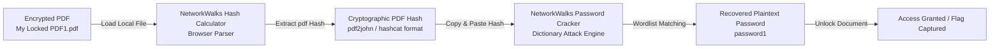

# NETWORKWALKS-B084-WK3-PM2-PASSWORD-CRACKING-WITH-NETWORKWALKS-TOOLS


<div align="center">

# 🔐 Penetration Testing Lab : Password Cracking with Networkwalks Tools

**Extracting Cryptographic PDF Hashes & Auditing Password Strength with Networkwalks Tools**
</div>

<p align="center">


## 📌 Project Overview
This project demonstrates how to extract cryptographic hashes and recover weak passwords from encrypted PDF files using browser-based security utilities developed by **NetworkWalks**: the **Hash Calculator** and the **Password Cracker**. Because both utilities operate directly inside a web browser with local client-side parsing, security professionals and students can perform hash extraction and dictionary attacks across Windows, Linux, or macOS without installing local binaries.

---

## 🎯 Purpose of the Lab
The purpose of this laboratory exercise is to demonstrate the mechanics of password auditing and dictionary-based credential recovery in a controlled environment. By extracting a `$pdf$` hash from a password-protected document and running an automated wordlist attack, this lab highlights how quickly weak or common passwords are compromised and reinforces strong password security practices.

---

## 🚀 Objectives
* **Understand Password Auditing:** Learn how password recovery works step-by-step from hash extraction to plaintext verification.
* **Differentiate Encryption vs. Hashing:** Distinguish between reversible two-way encryption and irreversible one-way cryptographic hashing.
* **Browser-Based Hash Extraction:** Extract a crackable `$pdf$` hash string from an encrypted PDF (`My Locked PDF1.pdf`) using the NetworkWalks Hash Calculator.
* **Dictionary Attack Execution:** Execute a wordlist-driven password attack using the NetworkWalks Password Cracker.
* **Security Awareness & Defense:** Analyze the vulnerability of short, predictable passwords and apply effective defensive mitigations.

---

## 🏗️ Lab Architecture & Environment
* **Operating System:** Windows 10 PRO
* **Hash Extraction Utility:** <https://networkwalks.com/hash-calculator> (client-side PDF hash parser)
* **Password Cracking Utility:** <https://networkwalks.com/password-cracker/> (browser-based dictionary attack engine)
* **Target Asset:** `My Locked PDF1.pdf` (Password-protected PDF document)



---

## 🛠️ Step-by-Step Lab Tasks

### 1. Download the Encrypted Target PDF
* Download the target encrypted file <https://networkwalks.com/project-task-lab-password-cracking-with-networkwalks-tools/>  to your local workstation.


### 2. Open the NetworkWalks Hash Calculator
* Launch your web browser and navigate to the <https://networkwalks.com/hash-calculator/>
* Select the **PDF** tab to prepare for file hash extraction.


### 3. Upload the Locked PDF File
* Click to choose or drag and drop `My Locked PDF1.pdf` into the Hash Calculator.
* The tool parses the file locally and extracts the cryptographic hash string starting with `$pdf$...`.


### 4. Copy the Complete Extracted Hash
* Click **Copy** (or manually highlight and copy) the full generated hash output.
  > **Note:** Ensure you copy the entire hash string starting from `$pdf$` without missing any characters or adding extra spaces.


### 5. Open the NetworkWalks Password Cracker
* Open a new browser tab and navigate to the <https://networkwalks.com/password-cracker/>


### 6. Paste the Hash & Start the Dictionary Attack
* Paste the copied `$pdf$` hash string into the **PDF HASH (`$pdf$...`)** input field.
* Verify the active wordlist (built-in list or custom `.txt` wordlist) and click **START CRACKING**.
* The tool iterates through candidate passwords in the dictionary until a cryptographic match is found.


### 7. Review the Cracked Password Output
* Wait for the dictionary attack to finish processing.
* Once matched, the tool displays **PASSWORD CRACKED SUCCESSFULLY** along with the recovered plaintext password (`password1`).


### 8. Open the Locked PDF & Enter the Password
* Locate `My Locked PDF1.pdf` on your computer and double-click to open it in your PDF reader.
* Enter the recovered password (`password1`) into the document password prompt and click **OK**.


### 9. Verify Document Access & Complete the Lab
* Confirm that the encrypted PDF unlocks and displays the congratulatory flag message (`You have captured your 1st flag.`).


## 📂 Repository Structure

```text
Password-Cracking-With-NetworkWalks-Tools/
├── README.md                                                  # Project documentation, Mermaid architecture & step-by-step walkthrough
├── target/
│   └── My Locked PDF1.pdf                                     # Encrypted PDF file audited in the authorized lab
└── screenshots/
    ├── task-01-download-target-pdf/
    │   └── 01_download_encrypted_pdf1_file.png                # Downloading My Locked PDF1.pdf from NetworkWalks lab page
    ├── task-02-open-hash-calculator/
    │   └── 02_open_networkwalks_hash_calculator.png           # Opening NetworkWalks Hash Calculator in web browser
    ├── task-03-upload-locked-pdf/
    │   └── 03_upload_pdf1_file_to_hash_calculator.png         # Uploading My Locked PDF1.pdf for local client-side parsing
    ├── task-04-copy-extracted-hash/
    │   └── 04_copy_the_hash_value.png                         # Copying the complete extracted pdf cryptographic hash
    ├── task-05-open-password-cracker/
    │   └── 05_open_networkwalks_password_cracker.png          # Opening NetworkWalks Password Cracker dictionary tool
    ├── task-06-execute-dictionary-attack/
    │   ├── 06_paste_hash_value_and_start_attack.png           # Pasting pdf hash and clicking START CRACKING
    │   └── 07_cracking_in_progress.png                        # Dictionary attack iterating through candidate words
    ├── task-07-review-cracked-password/
    │   └── 08_hash_value_cracked_successfully.png             # Plaintext password recovered (password1)
    ├── task-08-unlock-encrypted-pdf/
    │   ├── 09_open_pdf1_file.png                              # Opening My Locked PDF1.pdf in PDF reader
    │   └── 10_enter_password1.png                             # Entering recovered password (password1) into prompt
    └── task-09-verify-access-and-flag/
        └── 11_pdf1_file_opened_successfully.png               # Document unlocked and 1st flag captured
```


---

## 🧠 Key Takeaways & Defensive Mitigations
* **Encryption vs. Hashing:** Encryption is a two-way reversible function requiring a key to decrypt data, whereas hashing is a one-way mathematical function that transforms plaintext into a unique message digest.
* **Speed of Dictionary Attacks:** Common passwords such as `123456`, `password`, or `password1` are cracked almost instantaneously because they appear at the top of standard password dictionaries.
* **Enforce High Password Complexity:** An 8-character lowercase-only password can be cracked in minutes, whereas a 12+ character password mixing uppercase, lowercase, numbers, and symbols significantly increases cracking resistance.
* **Credential Hygiene & Reuse Prevention:** With billions of leaked credentials circulating from historical data breaches, organizations and users must avoid password reuse and implement Multi-Factor Authentication (MFA) wherever supported.

---

## 🔐 Security & Ethical Use
This laboratory and repository are intended strictly for educational and authorized research purposes only. All password auditing activities were conducted within the authorized <https://networkwalks.com> lab scope. Unauthorized cracking or exploitation of external files and systems is illegal.

## 🔗 Tools & Resources
* **Primary Environment:** Windows 10 PRO | <https:networkwalks.com> Week 3 | Project Module 2)
* **Browser-Based Utilities:** <https://networkwalks.com/hash-calculator/> | <https://networkwalks.com/password-cracker/>
* **Official Documentation:** <https://networkwalks.com> 

## 👤 Author
**Anderson Edaiyo Uzezi**  
Cybersecurity Professional B084  
LinkedIn: https://www.linkedin.com/in/anderson-edaiyo-bab74117b


## 📊 Project Information Matrix

> **Note:**  
> This repository contains the complete documentation, environment blueprints, and live verification logs for my Week 03 specialized laboratory deployment focusing on browser-based cryptographic hash extraction, dictionary-driven password auditing, and credential recovery.

| 🗂️ Project Parameter | ⚙️ Live Deployment Data |
| :--- | :--- |
| **Program Track** | Cybersecurity with Ethical Hacking |
| **Academy Module** | Networkwalks Academy Portfolio Matrix |
| **Timeline Horizon** | Week 03 Engineering Core |
| **Project Identity** | Password Cracking with NetworkWalks Tools |
| **Target Task ID** | TASK W3-PM2 |
| **Code Repository** | Public Deployment Hub via GitHub |


